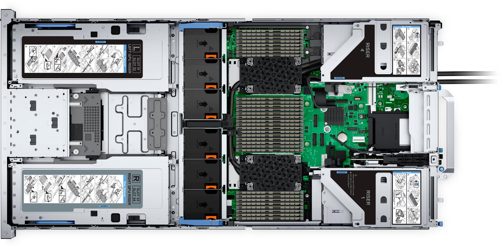

# compai-01.utu.fi

Documentation for the 2025 AI LLM server for Department of Computing.

**NOTE**: *The "novelty" of the server is to provide real-time inference (and for live demos, etc). CSC does not provide this as of 2026. CSC should still be used for training! Jupyter and other services are provided on-the-side as best effort.*

The server runs [ollama](https://github.com/ollama/ollama?tab=readme-ov-file) with [openwebui](https://openwebui.com/) as primary endpoint. This might/will change in the future as usage patterns are measured.

**WARNING**: There is no uptime guarantee, proper accounting, monitoring, batch jobs or prioritization presently (work in progress)!

### Services

 1. [**Open WebUI**](https://ai.tt.utu.fi/) ( **Try also**: https://ai.utu.fi ). 
    - Request new models in mattermost.
 2. Kubernetes "cluster" for hosting docker containers, etc. 
    - Admin interface: https://tt-rke.utu.fi/ (Ask via mattermost! Contact: lamkoi@utu.fi, emergency helpdesk@utu.fi and jauuks@utu)
    - Allows running batch jobs or semi-persistent services ([speech to text](https://github.com/ahmetoner/whisper-asr-webservice), etc?)

 3. Image/video generation via ComfyUI (planned)
 4. [JupyterHub](https://jupyter.tt.utu.fi/)
    - inform before using (in mattermost) or you may get blocked.
 5. [request!](https://gitlab-ext.utu.fi/tt.utu.fi/compai/-/issues/new)
 6. Direct ollama (temporary testing access until accounting system is set up): https://llm.tt.utu.fi/ (FUTURE: vLLM)
    - inform before using in mattermost or you may get blocked.
    - Request new models in mattermost!
    - Available models: https://llm-public-readonly.tt.utu.fi/api/tags

### Server specs

**PowerEdge R760XA Rack Server**

|      | Type                        | Details            |
|------|-----------------------------|--------------------|
| GPU1 | NVIDIA H100 NVL             | 95830MiB VRAM      |
| GPU2 | NVIDIA H100 NVL             | 95830MiB VRAM      |
| CPU1 | INTEL(R) XEON(R) GOLD 6526Y |                    |
| CPU2 | INTEL(R) XEON(R) GOLD 6526Y |                    |
| RAM  | 500GB                       | 16x 32GB DDR5      |
| HDD1 | 500GB                       | root /             |
| HDD2 | 2TB                         | /scratch (planned) |
| NFS  |                             | taltio tt-rke      |

Original exact config in [server-config-2025.csv](server-config-2025.csv)

### Storage

**There is VERY limited storage** (to be expanded). Therefore have a plan for archiving your data right after computation so other users can run their training as needed, otherwise data loss may occur (*there are no backups*).

In general, 1TB is used for /scratch storage in jupyter (not visible by default) with other 1TB going to ollama and system itself. 
UTU NFS storage is used for jupyter and it has no limits.

Therefore there is not much space for actual data storage, this is being remedied, but even then you should consider longer term archival.

**Solutions:**
 - [CSC Allas](https://docs.csc.fi/data/Allas/introduction/#billing-and-quotas) should be considered for archiving data. The owner of that data has to make the [CSC project](https://docs.csc.fi/accounts/how-to-create-new-project/).
 - https://seafile.utu.fi has 100GB initial personal quota
 - UTU network disk space (ask helpdesk) can also be used

### Rules 
 1. **For ollama / open webui users**: free-for-all until we start reaching limits.
 2. **Other uses**: You are required to remain vigilant and coordinate usage with other users via mattermost and yield storage/ram/vram as soon as possible. This is the price to pay for interactive non-batched usage.
 3. **For all**: Try to time large batch jobs to after hours/night/weekends, if possible.
 4. **For jupyter**: monitor storage closely. The available space is not much and if you take everything your files will be removed after a "business" day (if no contact) to free up storage for the rest. Therefore, join mattermost.

### Future
 - LLM course usage (2026?) instead of OpenAI (other usage lower priority)
 - see issues

### Contact
 1. https://mattermost.utu.fi/utu/channels/comp-ai (everything and anything!)
 2. sweng+info@utu.fi (research requests, generic inquiries)
 3. lamkoi+compai@utu.fi (technical)
 4. samnuutt+compai@utu (technical)
 5. [Head of department](https://tt.utu.fi/staff) ( Permissions, etc. )

### Use history and usage in publications

#### 2025 
 1. common chat usage via ai.tt.utu.fi
 2. Research attempt at training (TIERS/SwEng)
 3. Large batch jobs (SwEng PhD research)
 4. Data Analytics using for training for a publication (70GB+ VRAM required)

#### 2026
 1. chat usage including RAG, larger batch jobs (papuht@utu.fi)
 2. Student master's theses
     - Privacy-Focused Agentic AI Workflow with Locally Deployable Language Models for Technical Debt Remediation in Software Systems
     - Unfinished master's thesis with elements of RAG
 3. jupyter usage multiplying
    1. data analytics training continuing
    2. Model (vision?) training (mfhuma@utu.fi, lobirl@utu.fi)
    3. fine tuning of language models attempt (papuht@utu.fi)
 4. Initial testing local models viability for programming (lamkoi@utu.fi)
 5. Inquiries about specific usage (RAG, etc) from various people